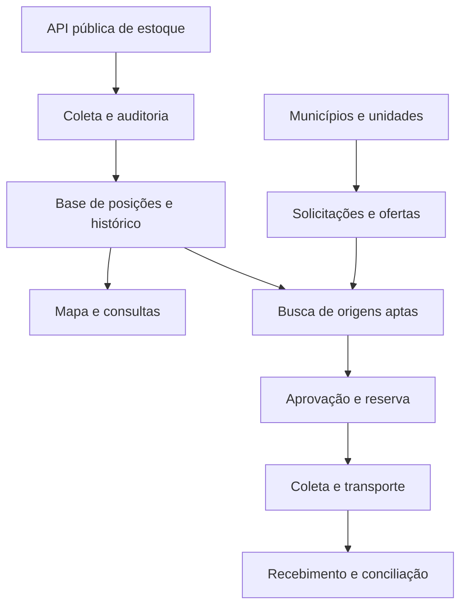
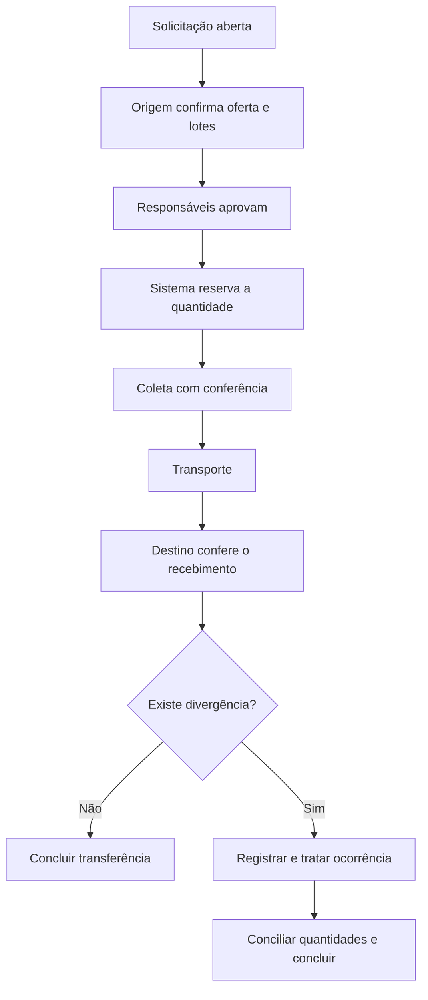

# med-share

Plataforma de redistribuição de medicamentos entre unidades de saúde. Reúne os dados públicos de estoque, recebe anúncios de falta e ajuda a encontrar unidades que possam transferir as quantidades necessárias, com acompanhamento até o recebimento.

> **Situação do projeto (06/11/2026):** em início de desenvolvimento. O repositório contém a base técnica (Laravel, Inertia e React, com autenticação). **As regras de negócio ainda não foram implementadas.** Da seção 1 em diante, este README descreve o sistema planejado: arquitetura, entidades, rotas e nomes de classes são propostas, e o que já existe está listado em [Estado atual do repositório](#estado-atual-do-repositório).

## Sumário

**Para começar**

- [Estado atual do repositório](#estado-atual-do-repositório)
- [Como rodar localmente](#como-rodar-localmente)
- [Comandos úteis](#comandos-úteis)

**Documentação do sistema**

1. [Visão do projeto](#1-visão-do-projeto)
2. [Escopo inicial e evolução](#2-escopo-inicial-e-evolução)
3. [Participantes e responsabilidades](#3-participantes-e-responsabilidades)
4. [Arquitetura proposta](#4-arquitetura-proposta)
5. [Módulos de negócio](#5-módulos-de-negócio)
6. [Integração com a fonte pública](#6-integração-com-a-fonte-pública)
7. [Auditoria e padronização](#7-auditoria-e-padronização)
8. [Regras de estoque e oferta](#8-regras-de-estoque-e-oferta)
9. [Solicitações e busca de origens](#9-solicitações-e-busca-de-origens)
10. [Aprovação, reserva e transferência](#10-aprovação-reserva-e-transferência)
11. [Modelo inicial de dados](#11-modelo-inicial-de-dados)
12. [Estrutura sugerida no Laravel](#12-estrutura-sugerida-no-laravel)
13. [API interna proposta](#13-api-interna-proposta)
14. [Filas, agendamento e configuração](#14-filas-agendamento-e-configuração)
15. [Configuração e ordem de implementação](#15-configuração-e-ordem-de-implementação)
16. [Proteção de acesso e operação](#16-proteção-de-acesso-e-operação)
17. [Observabilidade e indicadores](#17-observabilidade-e-indicadores)
18. [Testes e critérios de aceite](#18-testes-e-critérios-de-aceite)
19. [Decisões pendentes](#19-decisões-pendentes)
20. [Referências](#20-referências)

## Estado atual do repositório

### O que já existe

| Área | Situação |
| --- | --- |
| Backend | Laravel 13 (`^13.17`) em PHP `^8.3` |
| Frontend | React 19, TypeScript, Inertia 3, Tailwind CSS 4 e componentes Radix |
| Rotas tipadas no frontend | Laravel Wayfinder |
| Autenticação | Fortify com cadastro, redefinição de senha, verificação de e-mail, dois fatores e passkeys |
| Telas | Boas-vindas, login e demais fluxos de autenticação, dashboard e configurações (perfil, segurança e aparência) |
| Banco de dados | Migrations de usuários, cache, filas, passkeys e dois fatores; território, unidades, vínculos de acesso, catálogo de medicamentos, solicitações, ofertas, reservas e transferências (ver [`docs/banco-de-dados.md`](docs/banco-de-dados.md)) |
| Testes | PHPUnit, com testes de autenticação, dashboard e configurações |
| Qualidade | Pint, PHPStan (Larastan) e Vite+ (`vp check`) |
| Integração contínua | GitHub Actions em [`.github/workflows/tests.yml`](.github/workflows/tests.yml), com PHP 8.3 e Node 22 |

Esse conjunto vem do starter kit de React do Laravel. O `composer.json` ainda se identifica como `laravel/react-starter-kit`, e o `.env.example` ainda usa `APP_NAME=Laravel`.

### O que ainda não existe

Nada dos módulos de negócio da [seção 5](#5-módulos-de-negócio) foi implementado: integração com o BNAFAR, estoque, solicitações, ofertas, reservas e transferências. Também não existem `routes/api.php` e a API interna da [seção 13](#13-api-interna-proposta). A pasta `docs/` tem só a modelagem do banco.

### Diferenças entre o planejado e o repositório

| Tema | Documentação | Repositório hoje |
| --- | --- | --- |
| Banco | PostgreSQL | PostgreSQL 17 no `.env.example` e no `compose.yaml`; testes em SQLite em memória |
| Fila e cache | Redis | Driver `database` no `.env.example` |
| Interface do painel | A definir | Inertia e React, vindos do starter kit |
| Autenticação do painel | A definir | Fortify, com sessão |
| API autenticada | Sanctum, quando houver consumidores | Sanctum não instalado |

A interface e a autenticação continuam listadas como pendentes na [seção 19](#19-decisões-pendentes) até que a base atual seja confirmada como escolha do projeto.

## Como rodar localmente

Todo o ambiente roda em containers. **Só o Docker (com Compose) precisa estar instalado**: PHP, Composer, Node e PostgreSQL vêm nas imagens.

### Primeira vez

```bash
git clone https://github.com/Zero-Tokens/med-share.git
cd med-share
docker compose up -d --build
docker compose exec app php artisan db:seed
```

| Serviço | O que roda | Endereço |
| --- | --- | --- |
| `app` | Laravel (`php artisan serve`) | http://localhost:8000 |
| `vite` | Vite com hot reload | http://localhost:5173 |
| `queue` | Worker da fila (`queue:listen`) | — |
| `postgres` | PostgreSQL 17 | `127.0.0.1:5432`, banco/usuário/senha `med_share` |

Ao subir, o serviço `app` cria o `.env` a partir do `.env.example` (se não existir), roda o `composer install`, gera a `APP_KEY` e aplica as migrations. O serviço `vite` roda o `npm ci` quando o `node_modules` está ausente ou desatualizado.

O `db:seed` cria o usuário de teste `igor@gmail.com`, senha `12345`. O seeder só roda nos ambientes `local` e `testing`.

A imagem (`docker/app/Dockerfile`) usa o mesmo UID/GID do seu usuário, 1000 por padrão, então `vendor/`, `node_modules/` e os logs criados pelos containers continuam sendo seus. Se o seu UID for outro: `UID=$(id -u) GID=$(id -g) docker compose up -d --build`.

### Dia a dia

```bash
docker compose up -d          # sobe tudo
docker compose logs -f app    # acompanha os logs (app, vite, queue, postgres)
docker compose exec app bash  # terminal dentro do projeto
docker compose down           # para tudo (o banco fica no volume)
docker compose down -v        # para tudo e apaga o banco
```

Para usar outras portas: `APP_PORT=8080 VITE_PORT=5174 DB_FORWARD_PORT=5433 docker compose up -d`.

Com a configuração padrão, os e-mails vão para o log (`MAIL_MAILER=log`). O link de verificação de e-mail aparece em `storage/logs/laravel.log`.

O `.env` aponta o banco para o host `postgres`, o nome do serviço na rede do Docker. Fora dos containers, por exemplo na integração contínua, use `DB_HOST=127.0.0.1`.

Para usar Redis na fila e no cache, veja a [seção 15.1](#151-configurar-postgresql-e-redis).

## Comandos úteis

Rodam dentro do container `app`, prefixados por `docker compose exec app`:

| Comando | O que faz |
| --- | --- |
| `docker compose exec app php artisan test` | Roda os testes (SQLite em memória) |
| `docker compose exec app composer test` | Limpa a configuração em cache e roda Pint em modo de verificação, PHPStan e testes |
| `docker compose exec app composer ci:check` | Roda `vp check`, a checagem de tipos TypeScript e `composer test` |
| `docker compose exec app composer lint` | Formata o PHP com Pint |
| `docker compose exec app composer types:check` | Analisa o PHP com PHPStan |
| `docker compose exec app php artisan migrate` | Aplica migrations novas |
| `docker compose exec app php artisan db:seed` | Cria o usuário de teste |
| `docker compose exec app npm run build` | Compila os assets |
| `docker compose exec app npm run check:fix` | Verifica o frontend e aplica as correções automáticas |
| `docker compose exec app npm run types:check` | Checa os tipos TypeScript |

---

## 1. Visão do projeto

Desenvolver uma plataforma de abrangência nacional para consultar estoques de medicamentos, receber anúncios de falta e encontrar unidades que possam disponibilizar quantidades para transferência.

O sistema consumirá dados públicos de estoque e permitirá que municípios e unidades de saúde participem da operação com contas individuais. Os responsáveis poderão informar necessidades, confirmar ofertas, autorizar transferências e acompanhar o transporte até o recebimento.

A busca deve ampliar a área de atendimento: mesmo município, municípios próximos e demais regiões. Entre as origens aptas, a plataforma deve priorizar proximidade e capacidade de atender à necessidade.

### 1.1 Objetivos

- Centralizar os dados disponíveis de estoque em uma base consultável.
- Mostrar a origem e a atualização de cada informação.
- Receber solicitações de medicamentos por unidade de saúde.
- Encontrar ofertas compatíveis com cada solicitação.
- Controlar as quantidades reservadas e transferidas.
- Registrar coleta, entrega e divergências com rastreabilidade por lote.
- Medir o atendimento das solicitações e a qualidade dos dados.

### 1.2 Limites da proposta

A cobertura inicial corresponde aos registros disponíveis nas fontes integradas. Importar todos os dados disponíveis não comprova a cobertura de todos os estabelecimentos do Brasil.

O estoque da API representa uma posição informada em determinada data. A confirmação do responsável pela unidade é necessária para disponibilizar medicamentos para transferência.

A primeira versão não precisa substituir os sistemas locais de dispensação nem registrar dados de pacientes. A plataforma também não realizará substituição terapêutica automática.

## 2. Escopo inicial e evolução

| Etapa | Entrega | Condição para avançar |
| --- | --- | --- |
| Visibilidade nacional | Importação, auditoria, busca e mapa dos registros disponíveis | Conhecer cobertura, atualização e duração das coletas |
| Piloto operacional | Contas verificadas, solicitações e ofertas confirmadas | Validar participação e responsabilidades das unidades |
| Transferência completa | Aprovação, reserva, coleta, transporte e recebimento | Validar um ciclo completo entre unidades parceiras |
| Expansão | Novos municípios e integrações com sistemas locais | Demonstrar estabilidade e capacidade de acompanhamento |

O primeiro incremento deve permitir importar dados de uma região, consultar o estoque e identificar sua atualização. A coleta nacional pode avançar em paralelo ao piloto operacional.

## 3. Participantes e responsabilidades

| Participante | Responsabilidades |
| --- | --- |
| Administração da plataforma | Gerenciar adesões, acompanhar importações e tratar inconsistências |
| Gestor municipal | Vincular unidades e aprovar os responsáveis do município |
| Responsável da unidade | Declarar faltas, liberar ofertas e confirmar quantidades e lotes |
| Aprovador de transferência | Autorizar a operação conforme as regras dos participantes |
| Operador de logística | Registrar coleta, transporte e evidências de entrega |
| Auditor ou consulta | Consultar os registros autorizados sem alterar a operação |

Uma pessoa pode atuar em mais de uma unidade. Cada vínculo deve conter escopo, perfil, situação, responsável pela aprovação e datas de validade quando aplicáveis.

Criar uma conta não concede acesso operacional automaticamente. O vínculo com o município ou a unidade precisa de verificação. Usuários da logística acessam somente as transferências atribuídas ou autorizadas para seu escopo.

## 4. Arquitetura proposta

### 4.1 Monólito modular

Iniciar com uma aplicação Laravel organizada por responsabilidade de negócio, com implantação única e processamento assíncrono para tarefas demoradas.

Essa estrutura permite compartilhar regras de autorização e executar reservas dentro de transações, sem exigir comunicação distribuída entre serviços no início do projeto. Os módulos terão limites claros para permitir evolução posterior.

### 4.2 Visão lógica



As consultas do painel utilizam a base interna. A navegação do usuário não deve provocar uma coleta completa na fonte pública.

### 4.3 Componentes de execução

| Componente | Responsabilidade |
| --- | --- |
| Aplicação web e API interna | Autenticação, consultas e comandos operacionais |
| Banco relacional | Cadastros, posições de estoque, ofertas, reservas e transferências |
| Workers de fila | Importação, normalização, busca demorada, notificações e relatórios |
| Agendador | Iniciar sincronizações e tarefas de manutenção |
| Cache e coordenação | Cache de consultas e controle compartilhado das chamadas externas |
| Armazenamento privado | Evidências, comprovantes e arquivos de importação |

### 4.4 Base técnica sugerida

| Item | Proposta inicial |
| --- | --- |
| Framework | Laravel 13.x, com dependências fixadas pelo `composer.lock` |
| PHP | Versão compatível com Laravel 13, que exige no mínimo PHP 8.3 |
| Banco | PostgreSQL 17, com suporte a transações e índices adequados |
| Fila e cache | Redis como proposta para operação com vários workers |
| Autorização | Policies do Laravel e vínculos de acesso por município e unidade |
| API autenticada | Sanctum quando houver consumidores de API ou interface separada |
| Interface | Painel web, com tecnologia de frontend a definir |
| Implantação | Ambientes separados de desenvolvimento, homologação e produção |

A versão do Laravel e o requisito mínimo de PHP foram conferidos na documentação oficial [L1]. A configuração de banco, fila, interface e infraestrutura deve ser confirmada no início do projeto. O que o repositório usa hoje está em [Diferenças entre o planejado e o repositório](#diferenças-entre-o-planejado-e-o-repositório).

## 5. Módulos de negócio

| Módulo | Responsabilidades principais |
| --- | --- |
| Identidade e acesso | Contas, convites, vínculos, perfis e verificação de acesso |
| Território e unidades | Estados, municípios, CNES, endereço e coordenadas |
| Catálogo de medicamentos | Identidade do item, concentração, apresentação e unidade de fornecimento |
| Integrações | Cliente da fonte pública, execução e rastreamento das importações |
| Estoque externo | Posições importadas, histórico e projeção de consulta |
| Auditoria dos dados | Atualização, duplicidades, conflitos e registros em quarentena |
| Solicitações | Necessidades declaradas, itens, quantidade, urgência e prazo |
| Ofertas | Quantidades que as unidades confirmam poder transferir |
| Busca de origens | Compatibilidade, elegibilidade, proximidade e atendimento parcial |
| Reservas | Comprometimento de quantidades e proteção contra concorrência |
| Transferências | Aprovações, lotes, coleta, recebimento e conciliação |
| Logística | Execução do transporte e registro das condições aplicáveis |
| Indicadores | Qualidade da fonte e resultados operacionais |
| Notificações | Avisos de solicitações, aprovações, reservas e ocorrências |

## 6. Integração com a fonte pública

### 6.1 Fonte inicial

Fonte: API de Dados Abertos do Ministério da Saúde, endpoint de estoque BNAFAR/Hórus [S1].

```http
GET https://apidadosabertos.saude.gov.br/daf/estoque-medicamentos-bnafar-horus
```

Filtros documentados:

| Parâmetro | Uso |
| --- | --- |
| `codigo_uf` | Filtrar UF |
| `codigo_municipio` | Filtrar município |
| `codigo_cnes` | Filtrar estabelecimento |
| `anomes_posicao_estoque` | Filtrar competência no formato `AAAAMM` |
| `data_posicao_estoque` | Filtrar data no formato `AAAA-MM-DD` |
| `codigo_catmat` | Filtrar item com unidade de fornecimento |
| `sigla_programa_saude` | Filtrar programa |
| `tipo_produto` | Filtrar tipo de produto |
| `sigla_sistema_origem` | Filtrar sistema de origem |
| `limit` | Tamanho da página, até 1.000, padrão 100 |
| `offset` | Número da página, começando em zero |

Exemplo de consulta:

```bash
curl --get \
  'https://apidadosabertos.saude.gov.br/daf/estoque-medicamentos-bnafar-horus' \
  --data-urlencode 'limit=1000' \
  --data-urlencode 'offset=0' \
  --header 'Accept: application/json'
```

`offset` representa página nesse contrato. A próxima página é `1`, e não `1000`.

### 6.2 Contrato observado e validação inicial

Na consulta exploratória feita durante a idealização, o retorno apresentou a coleção `parametros`, com quantidade, lote, validade, identificação da unidade, localização e produto. O cliente deve validar esse formato, registrar alterações de contrato e manter exemplos de resposta para testes.

A consulta exploratória não valida toda a cobertura nem todos os casos da API. Antes da carga nacional, confirmar o tamanho efetivamente retornado das páginas, datas disponíveis, campos nulos e critérios de término da paginação.

### 6.3 Limite de consumo

Não foi identificado um rate limit oficial publicado. **Uma requisição por segundo é uma configuração inicial proposta**, sujeita a confirmação com o responsável pela fonte e ajuste conforme as respostas observadas.

O limitador deve ser compartilhado entre todos os workers que consomem a mesma fonte. Cada worker com seu próprio limite multiplicaria o tráfego total.

Prever timeout, espera progressiva com variação aleatória e tratamento de `429`, `Retry-After`, falhas de conexão e erros transitórios. Respostas inválidas ou erros permanentes devem gerar investigação, sem repetição indefinida.

### 6.4 Estratégia de sincronização

1. Abrir uma execução de importação e definir seu recorte.
2. Dividir a execução em partições, inicialmente por UF e, quando necessário, município e data.
3. Consultar uma página respeitando o limitador global.
4. Preservar a resposta original e seus metadados de coleta.
5. Validar o contrato e normalizar os registros.
6. Persistir o histórico de forma idempotente.
7. Registrar o checkpoint somente depois da persistência da página.
8. Publicar a posição consultável quando o recorte cumprir os critérios de consistência.
9. Encerrar a partição e consolidar os indicadores da execução.

Uma falha deve permitir retomar a partição sem reiniciar todo o país. A entrega de jobs pode ocorrer mais de uma vez, portanto cada página precisa admitir reprocessamento seguro.

Não há confirmação de um mecanismo de cursor estável ou de consulta de todos os registros alterados desde um instante. Filtro de data de posição não equivale a filtro de alteração. A estratégia incremental deve incluir revisita de datas e reconciliação periódica para encontrar correções e envios tardios.

Paginação sobre uma base em alteração pode repetir ou omitir registros. Registrar os filtros e a janela da coleta, verificar consistência e reprocessar recortes suspeitos antes de tratá-los como completos.

### 6.5 Atualização e integridade das posições

- Armazenar separadamente a data da posição e o instante da importação.
- Preservar o histórico e derivar uma projeção para consulta atual.
- Não somar posições de datas diferentes como estoque atual.
- Não zerar um saldo apenas porque ele não apareceu em uma página ou execução incompleta.
- Não combinar automaticamente lotes de snapshots incompatíveis.
- Preservar a última posição conhecida com indicação de desatualização quando não houver nova informação confiável.
- Uma confirmação operacional recente deve manter sua própria origem e data, sem reescrever o dado público.

A API será uma fonte de consulta. Esta integração não presume permissão ou capacidade de alterar os estoques oficiais.

## 7. Auditoria e padronização

### 7.1 Identificação dos cadastros

Armazenar CNES e códigos territoriais como texto, preservando zeros à esquerda. Diferenças de formato do código municipal devem usar um mapeamento territorial validado, sem completar dígitos por suposição.

Medicamentos devem possuir identidade interna e mapeamentos dos códigos externos, como CATMAT e, futuramente, OBM. A compatibilidade precisa considerar princípio ativo ou composição, concentração, forma farmacêutica, apresentação e unidade de fornecimento.

Não usar semelhança do nome como prova de equivalência. Mapeamentos ambíguos devem passar por revisão do responsável competente.

### 7.2 Duplicidades e conflitos

Preferir o identificador estável da origem, se houver. Na ausência dele, definir e validar uma chave composta que preserve as dimensões relevantes: fonte, unidade, produto, lote, validade, programa, sistema de origem e data da posição.

A combinação exata depende do contrato real. Registros com a mesma chave e valores conflitantes devem gerar uma ocorrência. Não somar nem descartar automaticamente registros cuja identidade permaneça ambígua.

Preservar os dados originais permite revisar a normalização sem consultar novamente toda a fonte.

### 7.3 Situações de qualidade

| Situação | Comportamento proposto |
| --- | --- |
| Atualizado | Exibir a posição e a data de referência |
| Desatualizado | Exibir a última posição e solicitar confirmação para uso operacional |
| Sem informação | Não classificar automaticamente como falta |
| Inconsistente | Registrar ocorrência e suspender o uso automático do dado afetado |
| Em quarentena | Aguardar revisão sem publicar o registro como saldo confiável |
| Confirmado pela unidade | Mostrar a confirmação com responsável e validade própria |

Os intervalos que definem atualização e validade das confirmações devem ser configuráveis. Seus valores precisam de validação com os parceiros do piloto.

Auditoria de dados e trilha de alterações não comprovam, sozinhas, o estoque físico de uma unidade.

## 8. Regras de estoque e oferta

### 8.1 Quantidades distintas

| Informação | Definição |
| --- | --- |
| Estoque externo | Posição registrada pela fonte pública |
| Quantidade liberada | Compromisso de oferta confirmado pela unidade |
| Reserva ativa | Quantidade comprometida, ainda sem coleta |
| Quantidade expedida | Quantidade que já saiu e consumiu a oferta |
| Saldo ofertável | Quantidade liberada menos reservas ativas e expedições |

```text
saldo_ofertavel = quantidade_liberada - reservas_ativas - quantidade_expedida
```

Exemplo hipotético: a fonte informa 1.000 comprimidos, a unidade libera 200 e o sistema reserva 80. O saldo para novas reservas é 120.

Quando os 80 forem coletados, a reserva passa para a situação correspondente e a quantidade expedida aumenta em 80 na mesma transação. O saldo continua 120. Finalizar uma reserva por coleta não pode devolver os medicamentos expedidos ao saldo ofertável.

O estoque externo é evidência de apoio e permanece separado desse controle. A unidade informa a quantidade liberada após considerar consumo local, reservas e estoque de segurança.

### 8.2 Regras obrigatórias

- Ofertas precisam de unidade responsável, validade de confirmação e identificação dos lotes antes da reserva definitiva.
- A quantidade liberada não pode ser reduzida abaixo dos compromissos existentes.
- Uma nova importação não apaga reservas, expedições ou confirmações operacionais.
- A soma das reservas concorrentes não pode superar o saldo da oferta.
- Quantidades usam representação decimal exata, com precisão permitida por unidade de fornecimento. Não usar `float` para os cálculos de saldo.
- Quantidades de apresentações diferentes não podem ser somadas sem conversão explícita e validada.
- Lotes vencidos, bloqueados ou sem confirmação suficiente não podem gerar novas reservas.
- Uma oferta vencida não admite novos compromissos. Compromissos já existentes exigem tratamento explícito.
- Devoluções e ajustes devem gerar eventos próprios, com conferência, justificativa e autorização.

Se não houver dados de consumo, o sistema não deve declarar excedente calculado como fato. Nesse caso, a oferta representa a liberação explícita pela unidade.

## 9. Solicitações e busca de origens

### 9.1 Solicitação de medicamento

Cada solicitação pertence a uma unidade de destino e contém um ou mais itens. Cada item informa medicamento, apresentação, unidade de fornecimento, quantidade necessária, urgência e prazo.

Permitir atendimento parcial e por várias origens. Manter quantidades solicitadas, comprometidas, expedidas e recebidas separadas para evitar atendimento duplicado.

### 9.2 Seleção de candidatos

Aplicar primeiro os critérios de elegibilidade:

1. Compatibilidade do medicamento e da unidade de fornecimento.
2. Unidade de origem e vínculo operacional habilitados.
3. Oferta confirmada, vigente e com saldo.
4. Lote e validade compatíveis com o prazo e o uso previsto.
5. Condições de transporte atendidas.
6. Autorizações e regras de transferência entre os participantes.

Depois, ordenar os candidatos pela área de busca e proximidade:

| Prioridade territorial | Origem |
| --- | --- |
| 1 | Mesmo município |
| 2 | Municípios próximos |
| 3 | Demais regiões |

A prioridade territorial é uma regra inicial proposta. O prazo, a urgência e as condições da operação podem justificar outra ordem, com motivo registrado.

Usar distância geográfica como pré-filtro. Calcular distância ou tempo de rota para os melhores candidatos quando houver um serviço de roteamento integrado. Coordenadas ausentes ou suspeitas devem impedir que a unidade apareça como a mais próxima sem validação.

Cada sugestão deve mostrar quantidade ofertável, distância estimada, atualização da informação e motivo da seleção. Uma sugestão não garante reserva nem autorização de transferência.

## 10. Aprovação, reserva e transferência

### 10.1 Fluxo operacional



Antes da reserva, confirmar que as aprovações continuam válidas para os itens, lotes e quantidades atuais. Alterações materiais invalidam as aprovações afetadas.

### 10.2 Estados separados por entidade

| Entidade | Estados propostos |
| --- | --- |
| Solicitação | `draft`, `open`, `partially_fulfilled`, `fulfilled`, `cancelled`, `closed_unfulfilled` |
| Oferta | `draft`, `active`, `paused`, `exhausted`, `expired`, `closed` |
| Reserva | `active`, `partially_collected`, `collected`, `released`, `expired`, `cancelled` |
| Transferência | `pending_approval`, `approved`, `reserved`, `ready_for_pickup`, `partially_collected`, `collected`, `in_transit`, `received_pending_review`, `disputed`, `completed`, `cancelled` |

Os estados devem ser implementados com transições explícitas. Uma solicitação fica `fulfilled` quando os itens atingirem as quantidades recebidas e aceitas, e não apenas pela criação de reservas. Coletas parciais mantêm o saldo restante da reserva identificado.

### 10.3 Concorrência e idempotência

A reserva deve ocorrer em transação, com bloqueio das linhas da oferta e do item solicitado, seguido de nova validação dos saldos, das aprovações e do escopo do usuário. Bloquear os registros em uma ordem consistente para reduzir deadlocks.

Reservas, coleta, liberação e expiração precisam disputar os mesmos bloqueios. Uma reserva coletada não pode expirar e liberar novamente a quantidade expedida.

Não depender somente do cache para garantir os saldos. A consistência final pertence ao banco de dados. O Laravel oferece transações e bloqueio pessimista para apoiar essa implementação [L5].

Comandos que alteram compromissos ou movimentações de estoque devem aceitar uma chave de idempotência. Persistir ator, operação, chave, hash do conteúdo e resultado, com unicidade adequada. Repetir a mesma chave e conteúdo devolve o resultado anterior. Reutilizar a chave com conteúdo diferente gera conflito.

Publicar notificações e jobs dependentes somente após a confirmação da transação. Quando for necessário garantir publicação mesmo com queda entre o commit e o envio, registrar um evento de saída na mesma transação e processá-lo por um publicador com tentativas idempotentes.

### 10.4 Exceções

- Cancelamento antes da coleta libera somente as reservas ainda não expedidas.
- Cancelamento após a coleta exige tratamento logístico e conciliação, sem recompor saldo automaticamente.
- Diferenças de lote ou quantidade geram ocorrência com evidências e responsável.
- Recebimentos parciais precisam identificar cada evento para não duplicar a quantidade aceita.
- A confirmação de uma entrega não altera automaticamente o estoque oficial da fonte pública.
- A baixa ou entrada no sistema local deve ser confirmada pelo participante ou executada por uma integração específica, quando existir.

## 11. Modelo inicial de dados

As tabelas abaixo são uma proposta de modelagem. Campos e relacionamentos devem ser refinados nas migrations do primeiro incremento.

| Tabela | Conteúdo principal |
| --- | --- |
| `users` | Contas individuais e situação de acesso |
| `municipalities` | Município e códigos territoriais de referência |
| `facilities` | Unidade, CNES, município, endereço e coordenadas |
| `municipality_memberships` | Vínculo e perfil do usuário no município |
| `facility_memberships` | Vínculo e perfil do usuário na unidade |
| `medications` | Identidade interna do medicamento e apresentação |
| `medication_mappings` | Códigos externos e situação do mapeamento |
| `integration_runs` | Execuções, período, parâmetros e resultado |
| `integration_partitions` | Recortes, páginas, checkpoints e tentativas |
| `integration_payloads` | Referência da resposta original e hash |
| `external_stock_positions` | Histórico de posições com as dimensões da origem |
| `external_stock_current` | Projeção consultável das posições válidas mais recentes |
| `data_quality_issues` | Conflitos, inconsistências e decisões de revisão |
| `medication_requests` | Solicitação, unidade de destino e situação |
| `medication_request_items` | Itens, quantidades, prazo e atendimento |
| `transfer_offers` | Oferta da unidade e validade da confirmação |
| `transfer_offer_lots` | Lotes, quantidades liberadas e compromissos |
| `reservations` | Vínculo entre item solicitado e lote ofertado |
| `transfers` | Origem, destino, aprovação e situação logística |
| `transfer_items` | Itens e lotes com quantidades previstas e realizadas |
| `transfer_approvals` | Decisões, responsáveis e versão dos itens aprovados |
| `transfer_events` | Eventos operacionais e evidências |
| `transfer_discrepancies` | Divergências e sua conciliação |
| `idempotency_keys` | Controle de repetição dos comandos |
| `outbox_events` | Eventos pendentes de publicação, quando adotado esse mecanismo |
| `audit_logs` | Alterações relevantes, ator, escopo e justificativa |

### 11.1 Índices e integridade

Relacionamentos principais:

- Um município possui várias unidades. Usuários se vinculam a municípios e unidades pelas tabelas de vínculo.
- Uma solicitação possui vários itens e um único destino.
- Uma oferta pertence a uma unidade de origem e possui lotes de um mesmo medicamento e apresentação.
- Um item solicitado pode receber várias reservas, inclusive de origens diferentes.
- Cada reserva associa um item solicitado a um lote ofertado e a uma transferência.
- Uma transferência possui uma única origem e um único destino. Atendimento por várias origens gera transferências distintas.
- Uma transferência possui itens, aprovações e eventos, podendo receber várias ocorrências.

Restrições e índices iniciais:

- CNES com restrição de unicidade quando representar a identidade única da unidade na fonte.
- Índices de estoque por unidade, medicamento e data da posição.
- Índices para ofertas por medicamento, situação, validade e unidade.
- Índices para solicitações por unidade, situação, urgência e prazo.
- Índices para reservas por oferta, situação e vencimento.
- Índices para transferências por origem, destino e situação.
- Restrições únicas para reprocessamento de importações e comandos idempotentes.
- Chaves estrangeiras e validações para impedir relacionamentos entre entidades incompatíveis.

Projeções e contadores derivados precisam de reconciliação com os eventos de origem. O histórico de importação deve ser separado das tabelas operacionais para evitar que consultas comuns percorram toda a base histórica.

### 11.2 Datas, quantidades e retenção

Persistir instantes em UTC e converter para o fuso do usuário ou da unidade na interface. Datas de validade e datas de posição sem horário devem manter sua semântica de data civil, sem conversões que mudem o dia.

Definir precisão decimal por unidade de fornecimento. Quantidade negativa ou fracionamento incompatível deve falhar na validação ou seguir para auditoria.

Definir uma política de retenção para payloads, histórico e anexos após medir volume. Não apagar evidências de transferências por uma rotina genérica de limpeza.

## 12. Estrutura sugerida no Laravel

Usar as convenções do framework e separar as ações por módulo. Evitar uma camada genérica de repositórios que apenas repita os métodos do Eloquent.

### 12.1 Pastas e arquivos

Esta é a estrutura de destino. Boa parte dos caminhos ainda não existe no repositório.

| Caminho | Responsabilidade |
| --- | --- |
| `app/Actions/Integrations/` | Planejar importações e publicar posições validadas |
| `app/Actions/MedicationRequests/` | Abrir, alterar e encerrar solicitações |
| `app/Actions/Offers/` | Confirmar, pausar e ajustar ofertas |
| `app/Actions/Reservations/` | Reservar, liberar e expirar quantidades |
| `app/Actions/Transfers/` | Aprovar, coletar, receber e conciliar transferências |
| `app/Integrations/Bnafar/` | Cliente HTTP, contrato da resposta e transformação da fonte |
| `app/Queries/Stock/` | Consultas de estoque e filtros do painel |
| `app/Queries/Matching/` | Busca e ordenação das origens aptas |
| `app/Jobs/Integrations/` | Coleta e processamento das páginas |
| `app/Jobs/Notifications/` | Entrega assíncrona de avisos |
| `app/Console/Commands/` | Comandos de coleta, conciliação e manutenção |
| `app/Http/Controllers/Api/V1/` | Entrada e saída das rotas internas |
| `app/Http/Requests/` | Validação dos dados recebidos |
| `app/Http/Resources/` | Contratos das respostas |
| `app/Http/Middleware/` | Contexto de acesso e verificações transversais |
| `app/Models/` | Entidades persistidas e relacionamentos |
| `app/Enums/` | Estados, perfis e tipos de evento |
| `app/Policies/` | Autorização por operação e escopo |
| `app/Events/` | Eventos de negócio confirmados |
| `app/Listeners/` | Reações aos eventos |
| `app/Notifications/` | Conteúdo e canais dos avisos |
| `app/Providers/AppServiceProvider.php` | Registro das dependências da integração |
| `bootstrap/app.php` | Registro das rotas, middleware e tratamento de exceções |
| `config/bnafar.php` | Configuração proposta para a integração |
| `config/redistribution.php` | Parâmetros propostos da operação |
| `database/migrations/` | Estrutura e restrições do banco |
| `database/factories/` | Dados para testes |
| `database/seeders/` | Cadastros de referência e dados controlados de desenvolvimento |
| `routes/api.php` | Rotas autenticadas e versionadas |
| `routes/web.php` | Rotas da interface web |
| `routes/console.php` | Agendamento e comandos simples |
| `tests/Feature/` | Contratos, autorização e fluxos integrados |
| `tests/Unit/` | Regras isoladas de compatibilidade, saldo e ordenação |
| `docs/` | Decisões de arquitetura, integração e operação |

As pastas adicionais representam organização do projeto, não um gerador nativo de módulos. Manter nomes de classes em inglês e documentação e mensagens de negócio em português.

### 12.2 Divisão de responsabilidades

| Elemento | Exemplo | Responsabilidade |
| --- | --- | --- |
| Controller | `ReservationController` | Receber o comando e devolver a resposta |
| Form Request | `StoreReservationRequest` | Validar formato, campos e autorização de entrada |
| Policy | `TransferPolicy` | Verificar o acesso à transferência |
| Action | `ReserveOfferQuantity` | Executar a regra e a transação de reserva |
| Query | `FindEligibleOrigins` | Consultar e classificar candidatos |
| Model | `Reservation` | Representar os dados e relacionamentos |
| Job | `ImportBnafarPage` | Executar a coleta de uma página |
| Integração | `BnafarClient` | Isolar URL, timeout, resposta e erros externos |

Controllers e jobs devem chamar as mesmas ações de negócio quando executarem a mesma operação. A validação de concorrência permanece dentro da ação transacional, mesmo quando a entrada já passou pelo Form Request.

## 13. API interna proposta

Prefixo: `/api/v1`. As rotas abaixo são propostas do sistema, distintas do endpoint público do Ministério da Saúde.

| Método | Rota | Finalidade |
| --- | --- | --- |
| GET | `/me` | Identidade e vínculos do usuário |
| GET | `/facilities` | Unidades visíveis para o contexto |
| GET | `/medications` | Catálogo normalizado |
| GET | `/stock-positions` | Consulta com data e procedência |
| GET | `/integration-runs` | Execuções autorizadas para administração |
| POST | `/integration-runs` | Solicitar coleta ao administrador autorizado |
| GET, POST | `/medication-requests` | Listar ou abrir solicitações |
| POST | `/medication-requests/{id}/cancel` | Cancelar respeitando os compromissos |
| GET | `/medication-request-items/{id}/origins` | Buscar origens aptas |
| GET, POST | `/offers` | Listar ou criar ofertas |
| POST | `/offers/{id}/confirm` | Confirmar a liberação e os lotes |
| POST | `/offers/{id}/pause` | Suspender novas reservas |
| POST | `/reservations` | Reservar quantidade com validação de saldo |
| POST | `/reservations/{id}/release` | Liberar a parte ainda não coletada |
| GET, POST | `/transfers` | Consultar ou criar proposta com origem, destino e itens |
| POST | `/transfers/{id}/approve` | Registrar uma aprovação |
| POST | `/transfers/{id}/collect` | Registrar coleta por item e lote |
| POST | `/transfers/{id}/receive` | Registrar a conferência do destino |
| POST | `/transfers/{id}/discrepancies` | Abrir ocorrência |
| POST | `/transfers/{id}/reconcile` | Conciliar uma divergência |
| GET | `/indicators` | Consultar indicadores no escopo permitido |

Respostas devem apresentar quantidades decimais como strings, datas explícitas e paginação. Comandos de reserva, coleta e recebimento exigem idempotência.

Exemplo proposto de resposta de conflito:

```json
{
  "success": false,
  "data": null,
  "error": {
    "code": "INSUFFICIENT_AVAILABLE_QUANTITY",
    "message": "A oferta não possui saldo suficiente para essa reserva.",
    "details": {
      "requested_quantity": "150.000",
      "available_quantity": "120.000"
    }
  }
}
```

Usar `409` para conflitos de saldo ou estado e `422` para dados inválidos. A autenticação e o escopo de autorização devem ser verificados em cada rota e na consulta do objeto, sem confiar no identificador enviado pelo cliente.

## 14. Filas, agendamento e configuração

### 14.1 Filas sugeridas

| Fila | Conteúdo |
| --- | --- |
| `imports` | Consultas externas e processamento das páginas |
| `operations` | Processos operacionais demorados e publicação de eventos |
| `notifications` | Avisos aos participantes |
| `reports` | Exportações e consolidações de maior volume |

Separar os workers para que a carga nacional não atrase avisos operacionais. Definir timeout, número de tentativas e política para jobs falhos. Os mecanismos de fila e despacho após commit são descritos pelo Laravel [L3].

### 14.2 Tarefas agendadas

- Iniciar a sincronização na frequência configurada e validada com o piloto.
- Revisitar partições com falha ou correções tardias.
- Expirar reservas e ofertas conforme suas regras.
- Identificar posições desatualizadas.
- Reconciliar contadores e detectar diferenças.
- Publicar eventos pendentes e consolidar indicadores.

Usar proteção contra sobreposição e, em ambiente com várias instâncias, coordenação para uma única execução da tarefa planejadora. A proteção do agendador não substitui os bloqueios e checkpoints das partições [L4].

### 14.3 Variáveis propostas da integração

```dotenv
BNAFAR_BASE_URL=https://apidadosabertos.saude.gov.br
BNAFAR_PAGE_SIZE=1000
BNAFAR_REQUESTS_PER_SECOND=1
BNAFAR_CONNECT_TIMEOUT_SECONDS=10
BNAFAR_TIMEOUT_SECONDS=30
BNAFAR_MAX_ATTEMPTS=5
```

Essas chaves são uma proposta do projeto e precisam de implementação em `config/bnafar.php`. Os números são valores iniciais de configuração, sem garantia da fonte. Validar o tamanho real das páginas e ajustar timeout e tentativas conforme as medições.

Reservas, prazo de confirmação da oferta e atualização do estoque também precisam de parâmetros próprios. Seus valores de negócio permanecem pendentes de definição.

## 15. Configuração e ordem de implementação

A aplicação já foi criada. Para instalar e executar, siga [Como rodar localmente](#como-rodar-localmente).

### 15.1 Configurar PostgreSQL e Redis

O ambiente proposto para o projeto substitui os drivers padrão do `.env.example`. Exemplo para desenvolvimento local:

```dotenv
APP_NAME="med-share"
APP_ENV=local
APP_DEBUG=true
APP_URL=http://localhost:8000

DB_CONNECTION=pgsql
DB_HOST=127.0.0.1
DB_PORT=5432
DB_DATABASE=med_share
DB_USERNAME=med_share
DB_PASSWORD=med_share

QUEUE_CONNECTION=redis
CACHE_STORE=redis
SESSION_DRIVER=database
REDIS_CLIENT=phpredis
REDIS_HOST=127.0.0.1
REDIS_PORT=6379
```

O `compose.yaml` já cria o banco e o usuário. Com um PostgreSQL próprio, criá-los antes das migrations. Disponibilizar Redis e a extensão compatível com `REDIS_CLIENT`, ou escolher um cliente suportado e instalar sua dependência. Os hosts do exemplo precisam mudar quando a aplicação rodar em containers.

Não recriar as migrations que já vieram na instalação. Manter o fuso da aplicação em UTC na configuração e nunca versionar o `.env` real.

Depois de ajustar o `.env`, rodar as migrations:

```bash
php artisan migrate
```

Quando houver jobs e tarefas agendadas, executar em terminais ou processos separados:

```bash
php artisan queue:work redis --queue=operations,notifications,imports,reports
```

```bash
php artisan schedule:work
```

O worker único serve para desenvolvimento. Em produção, separar os grupos de filas e manter workers supervisionados. O agendamento de produção deve seguir o mecanismo documentado pelo Laravel [L4].

### 15.2 Habilitar a API

A API interna depende das rotas de API e do Sanctum, ainda não instalados:

```bash
php artisan install:api
```

O comando habilita as rotas de API e instala o Sanctum [L2]. Para uma interface no mesmo domínio, preferir o fluxo de sessão e a proteção CSRF apropriada, sem emitir tokens pessoais para toda navegação.

### 15.3 Ordem de implementação

1. Criar cadastros territoriais, unidades e vínculos de acesso.
2. Implementar o cliente da fonte e importar uma partição pequena.
3. Preservar payloads e validar reprocessamento e paginação.
4. Construir a projeção de estoque e a consulta com atualização visível.
5. Implementar solicitações e ofertas confirmadas.
6. Implementar a reserva transacional e seus testes de concorrência.
7. Acrescentar aprovações, coleta e recebimento.
8. Tratar divergências, notificações e indicadores.
9. Expandir a coleta e validar a operação com municípios parceiros.

## 16. Proteção de acesso e operação

- Aplicar o escopo de município e unidade em Policies, consultas, exportações e downloads.
- Verificar novamente os vínculos nos jobs que atuarem em nome de um usuário.
- Manter evidências em armazenamento privado, com acesso temporário autorizado.
- Registrar ações relevantes com responsável, data, entidade afetada e justificativa.
- Separar permissões de solicitar, liberar medicamentos e aprovar quando o acordo operacional exigir.
- Limitar a exposição pública de estoques conforme a política acordada com os participantes.
- Proteger autenticação e comandos internos contra abuso com limites próprios da aplicação.
- Evitar dados de pacientes e documentos clínicos no escopo inicial.

A adesão dos municípios e os acordos de transferência devem definir quem pode aprovar e executar cada operação. A plataforma registra essas decisões e sua evidência.

## 17. Observabilidade e indicadores

### 17.1 Operação da integração

Medir duração das execuções, páginas processadas, registros válidos e rejeitados, última coleta bem-sucedida por partição, respostas de erro e volume das filas.

Cada execução e transferência deve ter um identificador de correlação nos logs. Alertas devem distinguir falha da fonte, atraso de processamento e inconsistência do dado.

### 17.2 Qualidade dos dados

Mostrar unidades com informação recente, unidades desatualizadas, registros em quarentena e distribuição das datas de posição. O indicador de cobertura deve informar seu denominador e não presumir participação de todo o país.

### 17.3 Resultado do projeto

Medir solicitações atendidas, atendimento parcial, tempo até reserva, tempo até entrega, cancelamentos e divergências. Quantidades devem ser agrupadas apenas para medicamentos, apresentações e unidades compatíveis.

Redução de perdas e melhoria de disponibilidade são hipóteses de impacto a medir com uma linha de base. Não apresentar metas ou resultados que ainda não foram observados.

## 18. Testes e critérios de aceite

### 18.1 Testes prioritários

- Resposta externa válida, vazia, inválida e com alteração de contrato.
- Paginação com várias páginas, repetição de página e falha no meio da coleta.
- Reprocessamento sem duplicação do mesmo registro.
- Nova importação sem apagar reservas ou zerar dados de execução incompleta.
- Dados antigos exibidos com sua data e situação correta.
- Usuário sem acesso tentando operar em outra unidade.
- Duas reservas concorrentes disputando o mesmo saldo.
- Concorrência entre coleta, liberação e expiração da mesma reserva.
- Coleta parcial, recebimento parcial e repetição de eventos.
- Cancelamento após coleta sem recomposição indevida da oferta.
- Aprovação invalidada após alteração de quantidade ou lote.
- Medicamentos incompatíveis excluídos da busca, mesmo com nomes parecidos.
- Ordenação de candidatos com coordenadas ausentes ou inválidas.

Os testes de concorrência devem usar o mesmo mecanismo de banco da operação. Um teste isolado com banco em memória não comprova o comportamento de bloqueios em produção. A suíte atual roda em SQLite em memória e precisará de um ambiente próprio para esses casos.

### 18.2 Critérios de aceite do primeiro incremento

1. Importar uma partição e registrar execução, páginas e resultado.
2. Retomar uma coleta interrompida sem duplicar dados.
3. Consultar estoque por unidade e medicamento com data e procedência.
4. Distinguir informação ausente, desatualizada e inconsistente.
5. Não somar posições de datas diferentes como saldo atual.
6. Preservar o payload original para investigação.
7. Aplicar autorização de administração sobre as importações.

### 18.3 Critérios de aceite do piloto operacional

1. Verificar o vínculo do responsável antes de permitir operações.
2. Abrir uma solicitação e confirmar uma oferta com lotes.
3. Encontrar origens aptas, ordenadas por proximidade.
4. Registrar as aprovações exigidas.
5. Reservar sem ultrapassar o saldo ou a quantidade necessária do destino.
6. Registrar coleta e recebimento sem duplicar quantidades.
7. Manter o saldo correto após coleta, expiração ou cancelamento.
8. Registrar e conciliar divergências com rastreabilidade.
9. Reconstruir o histórico de uma transferência pelos seus eventos.

## 19. Decisões pendentes

| Decisão | Por que precisa ser definida |
| --- | --- |
| Municípios e unidades do piloto | Determinar responsáveis e validar o ciclo operacional |
| Regras de transferência entre participantes | Definir aprovações e restrições de origem e destino |
| Validade das ofertas e reservas | Controlar o tempo dos compromissos |
| Critérios de atualização do estoque | Definir quando exigir reconfirmação |
| Catálogo e revisão de mapeamentos | Evitar associação incorreta de medicamentos |
| Escopo inicial de medicamentos | Validar necessidade de transporte e conferência específicos |
| Banco e infraestrutura de produção | Dimensionar volume, recuperação e operação |
| Interface e autenticação do painel | Confirmar ou substituir a base atual de Inertia, React e Fortify |
| Serviço de mapas e rotas | Medir proximidade e tempo realista de deslocamento |
| Canais de notificação | Definir como os participantes receberão e responderão aos avisos |
| Publicação de dados | Separar consultas públicas das informações operacionais restritas |
| Retenção e recuperação | Definir backups, restauração, histórico e evidências |

## 20. Referências

Documentação consultada em 06/11/2026. As fontes externas sustentam o contrato da integração e os mecanismos do framework. A arquitetura, as entidades e as regras operacionais deste documento são propostas do projeto.

- **[P1]** `Rede_de_Medicamentos.pptx`: apresentação de idealização do projeto, não versionada neste repositório.
- **[S1]** [Especificação da API de Dados Abertos do Ministério da Saúde](https://apidadosabertos.saude.gov.br/static/swagger.json).
- **[S2]** [FAQ do SI-BNAFAR](https://webatendimento.saude.gov.br/faq/sibnafar).
- **[L1]** [Laravel 13: versões e requisitos de PHP](https://github.com/laravel/docs/blob/13.x/releases.md).
- **[L2]** [Laravel: rotas de API e instalação do Sanctum](https://laravel.com/framework/docs/routing).
- **[L3]** [Laravel 13: filas e processamento após commit](https://laravel.com/framework/docs/13.x/queues).
- **[L4]** [Laravel 13: agendamento de tarefas](https://laravel.com/framework/docs/13.x/scheduling).
- **[L5]** [Laravel 13: consultas e bloqueio pessimista](https://laravel.com/framework/docs/13.x/queries).
- **[L6]** [Laravel 13: cliente HTTP](https://laravel.com/framework/docs/13.x/http-client).
- **[L7]** [Laravel 13: organização da aplicação](https://laravel.com/framework/docs/13.x/structure).
