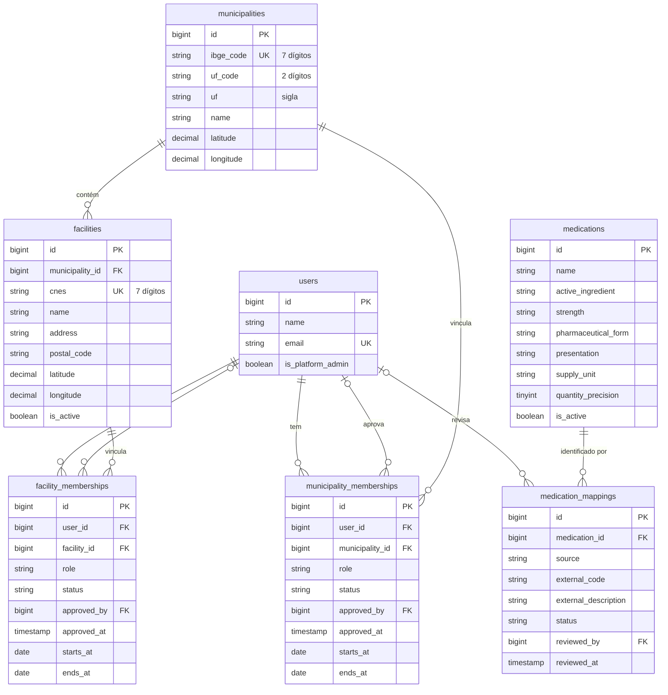

# Banco de dados

Modelagem do med-share. Este documento acompanha as migrations em `database/migrations/` e deve ser atualizado junto com elas.

Entregue até agora: **território, unidades, vínculos de acesso e catálogo de medicamentos** (issue #2, parte 1). As tabelas de solicitações, ofertas, reservas, transferências e importação dos dados oficiais entram nas próximas partes, seguindo a [seção 11 do README](../README.md#11-modelo-inicial-de-dados).

## Convenções

- Banco de desenvolvimento e produção: PostgreSQL 17. Testes: SQLite em memória. As migrations não usam recursos exclusivos de um deles (enums são colunas `string`, chaves estrangeiras com `constrained()`).
- Códigos de identificação externos (`ibge_code`, `uf_code`, `cnes`, `external_code`) são **texto**, para preservar zeros à esquerda.
- Quantidades usarão `decimal`; `medications.quantity_precision` diz quantas casas decimais cada unidade de fornecimento admite. Nunca `float`.
- Situações e perfis são `string` no banco e enums de PHP em `app/Enums/`.
- Instantes (`*_at` com hora) em UTC. `starts_at` e `ends_at` dos vínculos são datas civis, sem fuso.
- Remoção: um usuário removido leva seus vínculos junto (`cascade`) e deixa de ser referenciado como revisor ou aprovador (`set null`). Municípios e unidades com registros dependentes não podem ser removidos (`restrict`).

## Diagrama

## Dicionário de dados

Todas as tabelas têm `id` (bigint autoincremento), `created_at` e `updated_at`.

### `users`

Contas individuais. Vem do starter kit; a modelagem acrescentou uma coluna.

| Coluna | Tipo | Descrição |
| --- | --- | --- |
| `is_platform_admin` | boolean, padrão `false` | Administra a plataforma (adesões, importações, inconsistências). Não é vínculo com município ou unidade. |

### `municipalities`

Município e códigos territoriais de referência.

| Coluna | Tipo | Descrição |
| --- | --- | --- |
| `ibge_code` | string(7), único | Código IBGE do município, com 7 dígitos |
| `uf_code` | string(2) | Código IBGE da UF (ex.: `25`) |
| `uf` | string(2) | Sigla da UF (ex.: `PB`) |
| `name` | string | Nome do município |
| `latitude`, `longitude` | decimal(9,6), nulos | Coordenadas da sede, quando conhecidas |

Índices: `uf`.

### `facilities`

Unidade de saúde (estabelecimento com CNES).

| Coluna | Tipo | Descrição |
| --- | --- | --- |
| `municipality_id` | FK → `municipalities`, restrict | Município da unidade |
| `cnes` | string(7), único | Código CNES, com 7 dígitos |
| `name` | string | Nome da unidade |
| `address` | string, nulo | Endereço em texto |
| `postal_code` | string(8), nulo | CEP, só dígitos |
| `latitude`, `longitude` | decimal(9,6), nulos | Coordenadas. Ausentes ou suspeitas, a unidade não pode aparecer como "mais próxima" sem validação |
| `is_active` | boolean, padrão `true` | Unidade habilitada na plataforma |

Índices: (`municipality_id`, `is_active`).

### `municipality_memberships` e `facility_memberships`

Vínculo de um usuário com um município ou com uma unidade. Mesma estrutura; o que muda é a coluna de escopo (`municipality_id` ou `facility_id`). Uma pessoa pode ter vínculos em vários municípios e unidades, mas só um por escopo.

| Coluna | Tipo | Descrição |
| --- | --- | --- |
| `user_id` | FK → `users`, cascade | Usuário vinculado |
| `municipality_id` / `facility_id` | FK, restrict | Escopo do vínculo |
| `role` | string(30) | Perfil, enum `MembershipRole`: `municipal_manager`, `facility_responsible`, `transfer_approver`, `logistics_operator`, `auditor` |
| `status` | string(20) | Enum `MembershipStatus`: `pending`, `active`, `suspended`, `revoked`. Só `active` concede acesso |
| `approved_by` | FK → `users`, set null | Quem aprovou o vínculo |
| `approved_at` | timestamp, nulo | Quando foi aprovado |
| `starts_at`, `ends_at` | date, nulos | Validade do vínculo, quando houver |

Restrições: único (`user_id`, `municipality_id`) e único (`user_id`, `facility_id`). Índices: (`municipality_id`, `status`) e (`facility_id`, `status`).

Os perfis previstos para município são `municipal_manager`, `transfer_approver` e `auditor`; para unidade, `facility_responsible`, `transfer_approver`, `logistics_operator` e `auditor`. O banco não impõe essa separação; ela fica na validação das telas de cadastro.

### `medications`

Identidade interna do medicamento. A compatibilidade entre dois itens considera princípio ativo, concentração, forma farmacêutica, apresentação e unidade de fornecimento, e não o nome.

| Coluna | Tipo | Descrição |
| --- | --- | --- |
| `name` | string | Descrição de exibição (ex.: `Amoxicilina 500 mg cápsula`) |
| `active_ingredient` | string, nulo | Princípio ativo ou composição |
| `strength` | string, nulo | Concentração (ex.: `500 mg`) |
| `pharmaceutical_form` | string, nulo | Forma farmacêutica (ex.: `cápsula`) |
| `presentation` | string, nulo | Apresentação (ex.: `blister com 10`) |
| `supply_unit` | string | Unidade de fornecimento em que as quantidades são contadas (ex.: `comprimido`, `frasco`) |
| `quantity_precision` | tinyint, padrão `0` | Casas decimais permitidas nas quantidades dessa unidade |
| `is_active` | boolean, padrão `true` | Item disponível para novas solicitações e ofertas |

Índices: `name`, `active_ingredient`. **Não há unicidade por nome**: a identidade vem dos códigos externos mapeados.

### `medication_mappings`

Códigos externos (CATMAT, OBM) ligados a um medicamento interno, com situação de revisão.

| Coluna | Tipo | Descrição |
| --- | --- | --- |
| `medication_id` | FK → `medications`, cascade | Medicamento interno |
| `source` | string(20) | Enum `ExternalCodeSource`: `catmat`, `obm` |
| `external_code` | string(30) | Código na fonte, como texto |
| `external_description` | string, nulo | Descrição do item na fonte, preservada para revisão |
| `status` | string(20) | Enum `MedicationMappingStatus`: `pending`, `confirmed`, `rejected`. Só `confirmed` vale para compatibilidade |
| `reviewed_by` | FK → `users`, set null | Quem revisou |
| `reviewed_at` | timestamp, nulo | Quando foi revisado |

Restrições: único (`source`, `external_code`), ou seja, um código externo aponta para um só medicamento interno. Índices: (`medication_id`, `status`).

## Próximas partes

1. **Operação:** `medication_requests`, `medication_request_items`, `transfer_offers`, `transfer_offer_lots`, `reservations`, `transfers`, `transfer_items`, `transfer_approvals`, `transfer_events`, `transfer_discrepancies`.
2. **Importação e auditoria:** `integration_runs`, `integration_partitions`, `integration_payloads`, `external_stock_positions`, `external_stock_current`, `data_quality_issues`, `idempotency_keys`, `outbox_events`, `audit_logs`.
