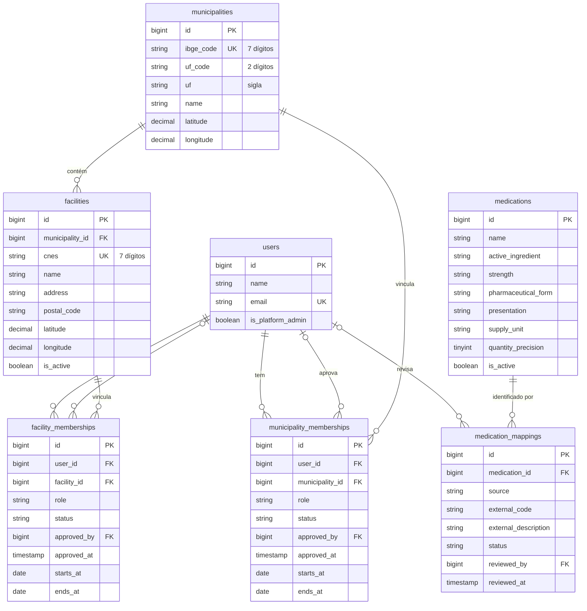
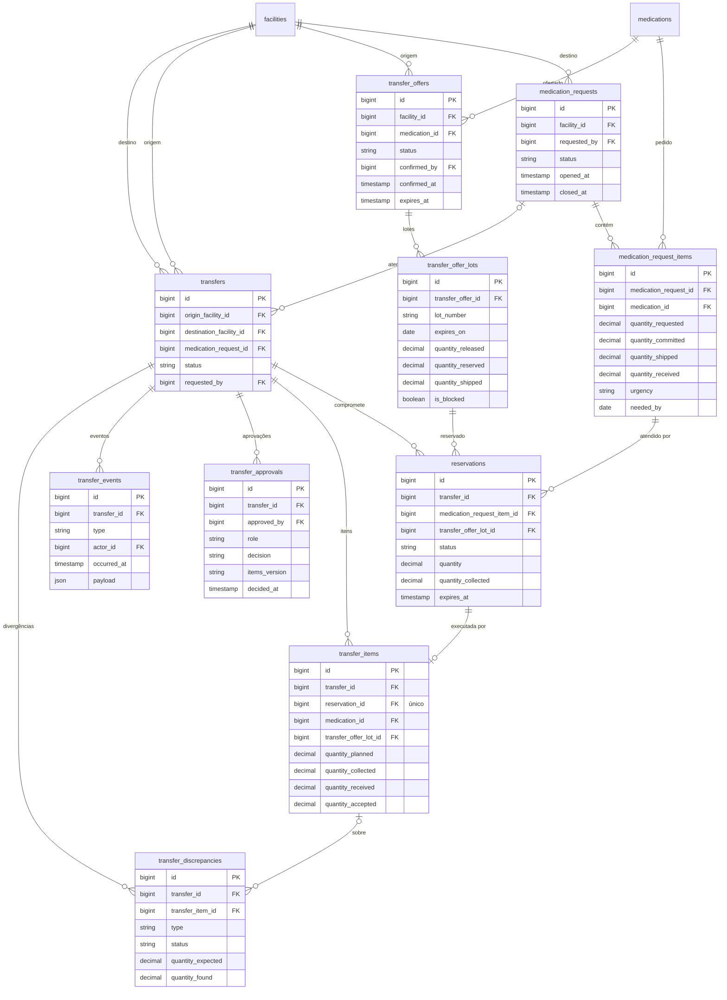

# Banco de dados

Modelagem do med-share. Este documento acompanha as migrations em `database/migrations/` e deve ser atualizado junto com elas.

Entregue até agora (issue #2): **parte 1**, território, unidades, vínculos de acesso e catálogo de medicamentos; **parte 2**, solicitações, ofertas, reservas e transferências. As tabelas de importação dos dados oficiais e auditoria entram na parte 3, seguindo a [seção 11 do README](../README.md#11-modelo-inicial-de-dados).

## Convenções

- Banco de desenvolvimento e produção: PostgreSQL 17. Testes: SQLite em memória. As migrations não usam recursos exclusivos de um deles (enums são colunas `string`, chaves estrangeiras com `constrained()`).
- Códigos de identificação externos (`ibge_code`, `uf_code`, `cnes`, `external_code`) são **texto**, para preservar zeros à esquerda.
- Quantidades são `decimal(14,3)` e chegam ao PHP como **string** (cast `decimal:3`); contas com `bcmath`, nunca `float`. `medications.quantity_precision` (0 a 3) diz quantas casas cada unidade de fornecimento admite; a validação dos comandos aplica esse limite.
- Situações e perfis são `string` no banco e enums de PHP em `app/Enums/`.
- Instantes (`*_at` com hora) em UTC. `starts_at` e `ends_at` dos vínculos são datas civis, sem fuso.
- Remoção: um usuário removido leva seus vínculos junto (`cascade`) e deixa de ser referenciado como revisor ou aprovador (`set null`). Municípios e unidades com registros dependentes não podem ser removidos (`restrict`).

## Diagrama

## Dicionário de dados

Todas as tabelas têm `id` (bigint autoincremento), `created_at` e `updated_at`.

### `users`

Contas individuais. Vem do starter kit; a modelagem acrescentou uma coluna.

| Coluna | Tipo | Descrição |
| --- | --- | --- |
| `is_platform_admin` | boolean, padrão `false` | Administra a plataforma (adesões, importações, inconsistências). Não é vínculo com município ou unidade. |

### `municipalities`

Município e códigos territoriais de referência.

| Coluna | Tipo | Descrição |
| --- | --- | --- |
| `ibge_code` | string(7), único | Código IBGE do município, com 7 dígitos |
| `uf_code` | string(2) | Código IBGE da UF (ex.: `25`) |
| `uf` | string(2) | Sigla da UF (ex.: `PB`) |
| `name` | string | Nome do município |
| `latitude`, `longitude` | decimal(9,6), nulos | Coordenadas da sede, quando conhecidas |

Índices: `uf`.

### `facilities`

Unidade de saúde (estabelecimento com CNES).

| Coluna | Tipo | Descrição |
| --- | --- | --- |
| `municipality_id` | FK → `municipalities`, restrict | Município da unidade |
| `cnes` | string(7), único | Código CNES, com 7 dígitos |
| `name` | string | Nome da unidade |
| `address` | string, nulo | Endereço em texto |
| `postal_code` | string(8), nulo | CEP, só dígitos |
| `latitude`, `longitude` | decimal(9,6), nulos | Coordenadas. Ausentes ou suspeitas, a unidade não pode aparecer como "mais próxima" sem validação |
| `is_active` | boolean, padrão `true` | Unidade habilitada na plataforma |

Índices: (`municipality_id`, `is_active`).

### `municipality_memberships` e `facility_memberships`

Vínculo de um usuário com um município ou com uma unidade. Mesma estrutura; o que muda é a coluna de escopo (`municipality_id` ou `facility_id`). Uma pessoa pode ter vínculos em vários municípios e unidades, mas só um por escopo.

| Coluna | Tipo | Descrição |
| --- | --- | --- |
| `user_id` | FK → `users`, cascade | Usuário vinculado |
| `municipality_id` / `facility_id` | FK, restrict | Escopo do vínculo |
| `role` | string(30) | Perfil, enum `MembershipRole`: `municipal_manager`, `facility_responsible`, `transfer_approver`, `logistics_operator`, `auditor` |
| `status` | string(20) | Enum `MembershipStatus`: `pending`, `active`, `suspended`, `revoked`. Só `active` concede acesso |
| `approved_by` | FK → `users`, set null | Quem aprovou o vínculo |
| `approved_at` | timestamp, nulo | Quando foi aprovado |
| `starts_at`, `ends_at` | date, nulos | Validade do vínculo, quando houver |

Restrições: único (`user_id`, `municipality_id`) e único (`user_id`, `facility_id`). Índices: (`municipality_id`, `status`) e (`facility_id`, `status`).

Os perfis previstos para município são `municipal_manager`, `transfer_approver` e `auditor`; para unidade, `facility_responsible`, `transfer_approver`, `logistics_operator` e `auditor`. O banco não impõe essa separação; ela fica na validação das telas de cadastro.

### `medications`

Identidade interna do medicamento. A compatibilidade entre dois itens considera princípio ativo, concentração, forma farmacêutica, apresentação e unidade de fornecimento, e não o nome.

| Coluna | Tipo | Descrição |
| --- | --- | --- |
| `name` | string | Descrição de exibição (ex.: `Amoxicilina 500 mg cápsula`) |
| `active_ingredient` | string, nulo | Princípio ativo ou composição |
| `strength` | string, nulo | Concentração (ex.: `500 mg`) |
| `pharmaceutical_form` | string, nulo | Forma farmacêutica (ex.: `cápsula`) |
| `presentation` | string, nulo | Apresentação (ex.: `blister com 10`) |
| `supply_unit` | string | Unidade de fornecimento em que as quantidades são contadas (ex.: `comprimido`, `frasco`) |
| `quantity_precision` | tinyint, padrão `0` | Casas decimais permitidas nas quantidades dessa unidade |
| `is_active` | boolean, padrão `true` | Item disponível para novas solicitações e ofertas |

Índices: `name`, `active_ingredient`. **Não há unicidade por nome**: a identidade vem dos códigos externos mapeados.

### `medication_mappings`

Códigos externos (CATMAT, OBM) ligados a um medicamento interno, com situação de revisão.

| Coluna | Tipo | Descrição |
| --- | --- | --- |
| `medication_id` | FK → `medications`, cascade | Medicamento interno |
| `source` | string(20) | Enum `ExternalCodeSource`: `catmat`, `obm` |
| `external_code` | string(30) | Código na fonte, como texto |
| `external_description` | string, nulo | Descrição do item na fonte, preservada para revisão |
| `status` | string(20) | Enum `MedicationMappingStatus`: `pending`, `confirmed`, `rejected`. Só `confirmed` vale para compatibilidade |
| `reviewed_by` | FK → `users`, set null | Quem revisou |
| `reviewed_at` | timestamp, nulo | Quando foi revisado |

Restrições: único (`source`, `external_code`), ou seja, um código externo aponta para um só medicamento interno. Índices: (`medication_id`, `status`).

## Operação: solicitações, ofertas, reservas e transferências

### Diagrama

### `medication_requests`

Necessidade declarada por uma unidade de destino.

| Coluna | Tipo | Descrição |
| --- | --- | --- |
| `facility_id` | FK → `facilities`, restrict | Unidade de destino |
| `requested_by` | FK → `users`, set null | Quem abriu |
| `status` | string(30) | Enum `RequestStatus`: `draft`, `open`, `partially_fulfilled`, `fulfilled`, `cancelled`, `closed_unfulfilled`. `fulfilled` só pelas quantidades recebidas e aceitas |
| `notes` | text, nulo | Observações |
| `opened_at`, `closed_at` | timestamp, nulos | Abertura e encerramento |

Índices: (`facility_id`, `status`).

### `medication_request_items`

Um item por medicamento dentro da solicitação. As quantidades ficam separadas para evitar atendimento duplicado.

| Coluna | Tipo | Descrição |
| --- | --- | --- |
| `medication_request_id` | FK, cascade | Solicitação |
| `medication_id` | FK → `medications`, restrict | Medicamento, com apresentação e unidade de fornecimento |
| `quantity_requested` | decimal(14,3) | Necessária |
| `quantity_committed` | decimal(14,3) | Reservada em transferências ativas |
| `quantity_shipped` | decimal(14,3) | Já expedida pelas origens |
| `quantity_received` | decimal(14,3) | Recebida e aceita no destino |
| `urgency` | string(20) | Enum `RequestUrgency`: `routine`, `urgent`, `critical` |
| `needed_by` | date, nulo | Prazo |

Restrições: único (`medication_request_id`, `medication_id`). Índices: (`medication_id`, `urgency`, `needed_by`).

### `transfer_offers`

Liberação explícita de uma unidade de origem para um medicamento. Não é o estoque da fonte pública.

| Coluna | Tipo | Descrição |
| --- | --- | --- |
| `facility_id` | FK → `facilities`, restrict | Unidade de origem |
| `medication_id` | FK → `medications`, restrict | Medicamento ofertado |
| `status` | string(20) | Enum `OfferStatus`: `draft`, `active`, `paused`, `exhausted`, `expired`, `closed`. Só `active` admite reservas |
| `confirmed_by`, `confirmed_at` | FK set null, timestamp | Responsável e momento da confirmação |
| `expires_at` | timestamp, nulo | Validade da confirmação da unidade |
| `notes` | text, nulo | Observações |

Índices: (`medication_id`, `status`, `expires_at`), (`facility_id`, `status`).

### `transfer_offer_lots`

Lotes liberados dentro de uma oferta, com o controle de saldo.

| Coluna | Tipo | Descrição |
| --- | --- | --- |
| `transfer_offer_id` | FK, cascade | Oferta |
| `lot_number` | string(50) | Número do lote |
| `expires_on` | date | Validade do lote (data civil) |
| `quantity_released` | decimal(14,3) | Liberada pela unidade |
| `quantity_reserved` | decimal(14,3) | Comprometida em reservas ativas |
| `quantity_shipped` | decimal(14,3) | Já coletada; consome a oferta e nunca volta ao saldo |
| `is_blocked` | boolean | Lote bloqueado para novas reservas |

Restrições: único (`transfer_offer_id`, `lot_number`). Índices: `expires_on`.

**Saldo ofertável** = `quantity_released − quantity_reserved − quantity_shipped`, calculado por `TransferOfferLot::availableQuantity()` com `bcmath`; não é gravado. A liberada não pode cair abaixo dos compromissos, e a soma das reservas concorrentes não pode passar do saldo: regras das ações, em transação com bloqueio de linha.

### `transfers`

Proposta de transferência entre uma origem e um destino. Atendimento por várias origens gera transferências distintas.

| Coluna | Tipo | Descrição |
| --- | --- | --- |
| `origin_facility_id`, `destination_facility_id` | FK → `facilities`, restrict | Origem e destino (devem ser diferentes; validado nas ações) |
| `medication_request_id` | FK, restrict, nulo | Solicitação atendida |
| `status` | string(30) | Enum `TransferStatus`: `pending_approval`, `approved`, `reserved`, `ready_for_pickup`, `partially_collected`, `collected`, `in_transit`, `received_pending_review`, `disputed`, `completed`, `cancelled` |
| `requested_by` | FK → `users`, set null | Quem propôs |
| `approved_at` … `cancelled_at` | timestamps, nulos | Marcos do fluxo |
| `notes` | text, nulo | Observações |

Índices: (`origin_facility_id`, `status`), (`destination_facility_id`, `status`), `medication_request_id`.

### `reservations`

Compromisso de quantidade entre um item solicitado, um lote ofertado e uma transferência. Protege o saldo da oferta contra concorrência.

| Coluna | Tipo | Descrição |
| --- | --- | --- |
| `transfer_id` | FK → `transfers`, restrict | Transferência; não se apaga transferência com reserva |
| `medication_request_item_id` | FK, restrict | Item atendido |
| `transfer_offer_lot_id` | FK, restrict | Lote comprometido |
| `status` | string(30) | Enum `ReservationStatus`: `active`, `partially_collected`, `collected`, `released`, `expired`, `cancelled`. Reserva coletada não expira nem é liberada |
| `quantity` | decimal(14,3) | Reservada |
| `quantity_collected` | decimal(14,3) | Já coletada desta reserva |
| `expires_at` | timestamp, nulo | Vencimento da reserva |
| `reserved_by` | FK → `users`, set null | Quem reservou |

Índices: (`transfer_offer_lot_id`, `status`), (`medication_request_item_id`, `status`), `transfer_id`, (`status`, `expires_at`).

### `transfer_items`

Execução física de uma reserva: previsto, coletado, recebido e aceito. Um para um com a reserva.

| Coluna | Tipo | Descrição |
| --- | --- | --- |
| `transfer_id` | FK, cascade | Transferência |
| `reservation_id` | FK, restrict, **único** | Reserva executada |
| `medication_id` | FK, restrict | Medicamento |
| `transfer_offer_lot_id` | FK, restrict | Lote |
| `quantity_planned` | decimal(14,3) | Previsto (= reserva) |
| `quantity_collected` | decimal(14,3) | Conferido na coleta |
| `quantity_received` | decimal(14,3) | Conferido no recebimento |
| `quantity_accepted` | decimal(14,3) | Aceito após conciliação |

Índices: `transfer_id`, `medication_id`, `transfer_offer_lot_id`.

### `transfer_approvals`

Decisões registradas sobre a transferência.

| Coluna | Tipo | Descrição |
| --- | --- | --- |
| `transfer_id` | FK, cascade | Transferência |
| `approved_by` | FK → `users`, **restrict** | Quem decidiu; usuário com aprovações não pode ser removido |
| `role` | string(30) | Enum `MembershipRole` em que a pessoa decidiu |
| `decision` | string(20) | Enum `ApprovalDecision`: `approved`, `rejected` |
| `items_version` | string(64) | Hash dos itens, lotes e quantidades aprovados; alteração material invalida a aprovação |
| `notes` | text, nulo | Justificativa |
| `decided_at` | timestamp | Momento da decisão |

Índices: (`transfer_id`, `decision`).

### `transfer_events`

Trilha operacional. A sequência de eventos reconstrói o histórico da transferência.

| Coluna | Tipo | Descrição |
| --- | --- | --- |
| `transfer_id` | FK, cascade | Transferência |
| `type` | string(40) | Enum `TransferEventType`: `created`, `approved`, `rejected`, `reserved`, `ready_for_pickup`, `collected`, `in_transit`, `received`, `disputed`, `reconciled`, `completed`, `cancelled`, `note` |
| `actor_id` | FK → `users`, set null | Responsável |
| `occurred_at` | timestamp | Quando aconteceu |
| `payload` | json, nulo | Quantidades, lotes, referências de evidências |
| `notes` | text, nulo | Observações |

Índices: (`transfer_id`, `occurred_at`).

### `transfer_discrepancies`

Divergências apontadas na coleta ou no recebimento e sua conciliação.

| Coluna | Tipo | Descrição |
| --- | --- | --- |
| `transfer_id` | FK, cascade | Transferência |
| `transfer_item_id` | FK, cascade, nulo | Item afetado, quando houver |
| `type` | string(30) | Enum `DiscrepancyType`: `quantity`, `lot`, `expiry`, `damage`, `other` |
| `status` | string(20) | Enum `DiscrepancyStatus`: `open`, `reconciled`, `dismissed` |
| `quantity_expected`, `quantity_found` | decimal(14,3), nulos | Esperado e encontrado |
| `description` | text | Relato |
| `reported_by`, `reconciled_by` | FK → `users`, set null | Quem apontou e quem conciliou |
| `reconciled_at`, `resolution` | timestamp, text, nulos | Conciliação |

Índices: (`transfer_id`, `status`), `transfer_item_id`.

## Próxima parte

**Importação e auditoria:** `integration_runs`, `integration_partitions`, `integration_payloads`, `external_stock_positions`, `external_stock_current`, `data_quality_issues`, `idempotency_keys`, `outbox_events`, `audit_logs`.
